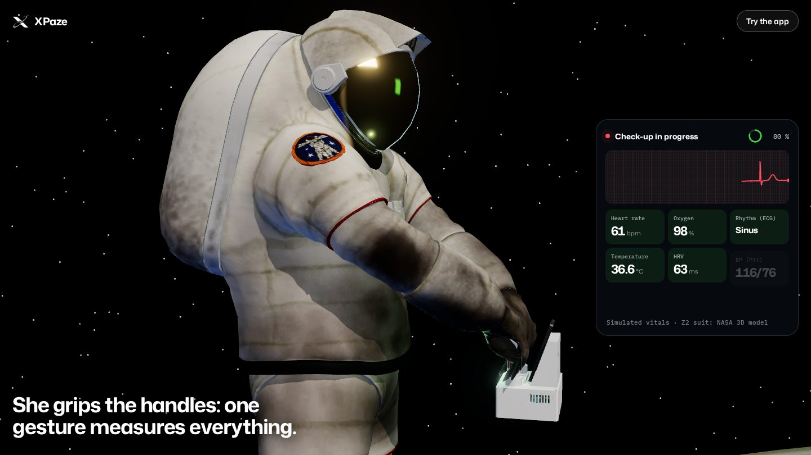
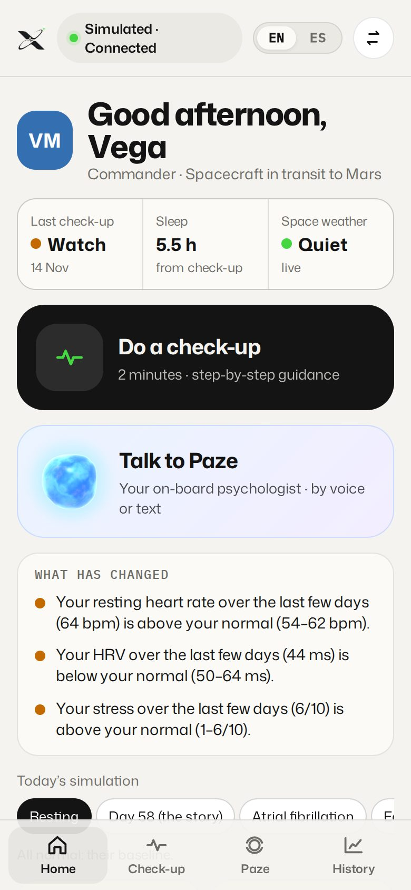
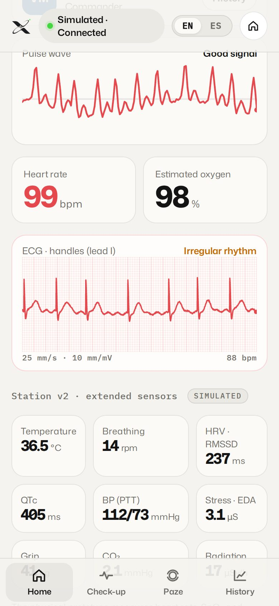
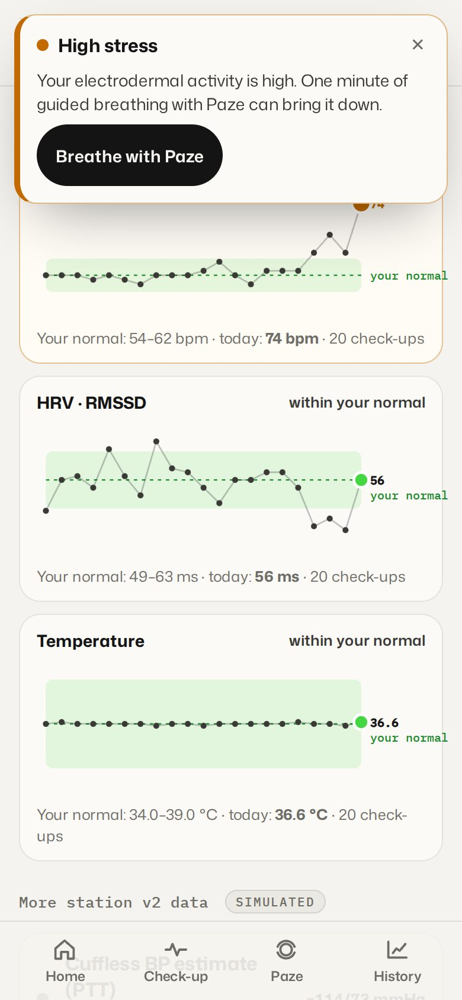
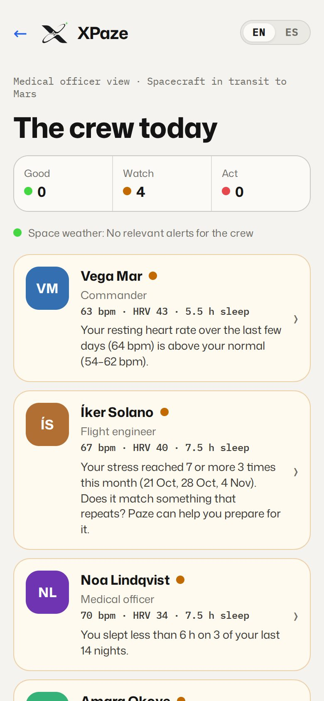
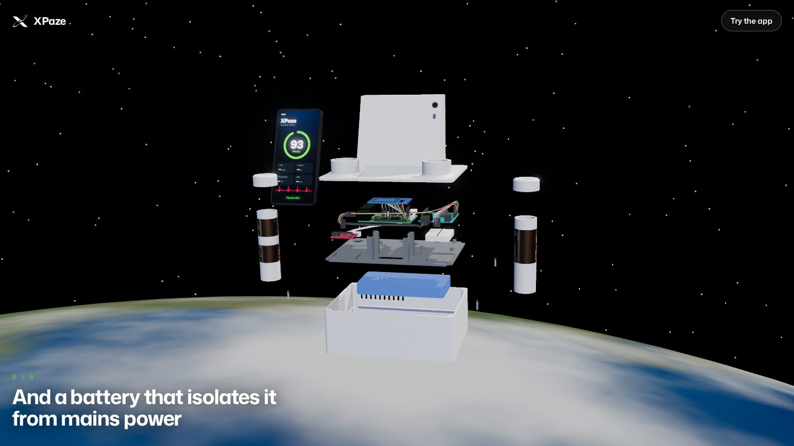

<div align="center">


# XPaze

### Health for those who travel beyond Earth

**XPaze learns what each astronaut is like, notices when they are no longer themselves and explains why.<br/>No cables, no waiting on Earth.**

[**Live site**](https://xpaze.es) · [**Try the app**](https://xpaze.es/app/) · [**3D scene**](https://xpaze.es/astronaut/) · [Medical sources](docs/medical-thresholds.md) · [AI use](AI_USE.md) · [Español](README.es.md)



</div>

---

## The problem

On the way to Mars, a message to Earth takes up to **22 minutes each way**. If something is wrong with a crew member, nobody on the ground can react in time, and there may be no doctor on board.

Today's monitors compare everyone with the **same fixed thresholds**. But a resting heart rate of 72 bpm is normal for one person and a warning for an athlete whose normal is 49.

## The idea

**XPaze compares you with yourself.** A small station on board takes a full check-up in one gesture, a traffic light with fixed and citable rules says how urgent it is, and an AI explains it in plain language. An on-board AI psychologist, **Paze**, looks after the mind.

| | |
|---|---|
| **One gesture** | Grip the two handles: ECG, heart rate, oxygen, temperature, breathing, HRV, QTc, blood pressure, stress and grip strength. |
| **You versus your normal** | Each value is compared with your own baseline (median ± 2.5 robust SD), not only with the general range. |
| **Explainable traffic light** | Fixed thresholds from NEWS2, ACC/AHA, ADA, ESC and NASA-STD-3001. **The AI never decides a color.** |
| **Paze** | An AI psychologist by voice and text. It opens the session, knows your data and history, and guides breathing exercises. |
| **Autonomy** | Live NASA space weather, assessed for where you are. Built for when Earth is slow to answer. |

## See it

<table>
<tr>
<td width="25%"></td>
<td width="25%"></td>
<td width="25%"></td>
<td width="25%"></td>
</tr>
<tr>
<td align="center"><b>Home</b><br/>What has changed, at a glance</td>
<td align="center"><b>Live ECG</b><br/>Atrial fibrillation detected from the beats</td>
<td align="center"><b>You vs your normal</b><br/>In range for anyone, out of range for her</td>
<td align="center"><b>Medical officer view</b><br/>The whole crew, by priority</td>
</tr>
</table>



<p align="center"><i>The XPaze Station opens piece by piece in the <a href="https://xpaze.es/astronaut/">3D scene</a>.</i></p>

## What is inside

| Part | What it does |
|---|---|
| **App** (`/app/`, PWA) | Guided check-up, live ECG and sensors, traffic light, AI explanation, 30-day history, trends, crew view, live alerts, Paze, and a 60-second self-playing demo. English and Spanish. |
| **Simulated station v2** | A body simulated **beat by beat**: single-lead ECG at 250 Hz, pulse wave, temperature, breathing, HRV, QTc, cuffless blood pressure, electrodermal activity, grip strength, cabin CO₂ and a radiation dosimeter. 11 situations, from atrial fibrillation to a solar storm. |
| **Paze** | AI psychologist: Claude for text, OpenAI Realtime for live voice. Session memory stays on the device. Crisis protocol with emergency resources. |
| **Website** (`/`) | Landing page with a live ECG, the 12 sensors, the live Earth–Mars delay and the NASA data we use. |
| **3D scene** (`/astronaut/`) | The station taken apart in 8 steps, then an astronaut in NASA's Z2 suit doing a check-up. |
| **Physical prototype** | Arduino Uno + Raspberry Pi: heart rate and SpO₂, cabin air and an RFID reader, over Bluetooth and WiFi. |
| **Android companion** | XPaze Link reads real Galaxy Watch data through Health Connect. |

## How it decides

```
 sensors ──▶ fixed thresholds ──▶ traffic light ──▶ action plan
                    ▲                                    │
        your own baseline (median ± 2.5 MAD)             ▼
                                                 AI explains it
                                             (it cannot change it)
```

- **Fixed rules set the color.** Every threshold has a source in [`docs/medical-thresholds.md`](docs/medical-thresholds.md).
- **Your baseline can raise a value to yellow** when it is far from your normal. Red only comes from the absolute thresholds.
- **Heart rate, HRV and rhythm are computed from the beats**, with the same function the hardware would use. The test suite runs 25 resting people with no false arrhythmia, and detects atrial fibrillation and ectopic beats every time.
- **The AI only explains.** It receives a result that is already classified.

## NASA data we use

| Data | How we use it |
|---|---|
| **[DONKI](https://api.nasa.gov)** (NASA CCMC) | **Live.** Space weather alerts from the last 7 days, assessed with fixed rules for the mission environment. |
| **[JPL Horizons](https://ssd.jpl.nasa.gov/horizons/)** | Checks the Earth–Mars light delay computed in the browser. |
| **[NASA-STD-3001 Vol. 2](https://www.nasa.gov/wp-content/uploads/2023/12/ochmo-tb-002-eclss.pdf)** | Cabin limits: temperature, humidity, pressure and CO₂. |
| **[Human Research Program](https://humanresearchroadmap.nasa.gov/risks/)** | Each measurement maps to an official health risk. |
| **[OSDR](https://visualization.osdr.nasa.gov/eda/)** | ISS cabin data as a reference for realistic simulated values. OSD-569 (Inspiration4) inspired the personal baseline. |
| **[NASA 3D Resources](https://github.com/nasa/NASA-3D-Resources)** | The Z2 spacesuit model in the 3D scene. |

XPaze is not affiliated with or endorsed by NASA.

## Run it

```bash
npm install
npm run dev          # website, app and 3D scene on http://localhost:5192
npm test             # 96 tests
```

The AI features need the small server in `server/psicologa.js`:

```bash
cp .env.example .env    # add your ANTHROPIC_API_KEY (and OPENAI_API_KEY for voice)
node --env-file=.env server/psicologa.js
```

Without it, the app still works: the traffic light, the guidance, the history and the simulated station need no AI and no internet.

<details>
<summary><b>Project layout</b></summary>

```
index.html, src/main.js, src/landing/   landing page
app/, src/app/                          the app (PWA)
  clinical.js                           thresholds, action plans (single source of truth)
  simbody.js                            the body simulated beat by beat
  story.js                              30-day histories, trends, report
  space.js                              space weather rules
astronaut/, src/scene/                  3D scene (three.js)
legal/                                  legal notice, privacy, cookies, terms
server/psicologa.js, server/donki.js    AI server and NASA DONKI client
sensors/                                Raspberry Pi bridge (USB, Bluetooth, WiFi)
firmware/xpaze-station/                 Arduino firmware
android/xpaze-link/                     Android companion app
tests/                                  96 tests (JavaScript) + Python tests
docs/medical-thresholds.md              every threshold, with its source
```

</details>

<details>
<summary><b>Physical station</b></summary>

- Arduino Uno with a MAX3010x (heart rate and SpO₂), AHT20 + BMP280 (cabin air) and an RC522 (RFID), all at 3.3 V.
- Raspberry Pi bridge: `sensors/bridge.py` serves the app over WiFi and advertises a Bluetooth GATT service.
- `sensors/arduino-watch.sh` flashes the firmware and switches the bridge to real mode when the board is stable.
- `scripts/pi-deploy.sh` updates the Pi.

</details>

## Honest limits

- **XPaze is a research prototype, not a medical device.** It does not diagnose or treat.
- **The station v2 sensors are simulated** with published physiological values. The physical prototype measures heart rate, SpO₂ and cabin air.
- **The crew is fictional.** Real physiological data from astronauts is not public.
- The thresholds come from general clinical references and have not been validated for spaceflight.

## AI use

We used AI to build XPaze and inside the product, and we declare it in full: [AI_USE.md](AI_USE.md).

## Team

**Los Zenith** · Málaga, Spain · [contacto@xpaze.es](mailto:contacto@xpaze.es) · [Legal](https://xpaze.es/legal/)
